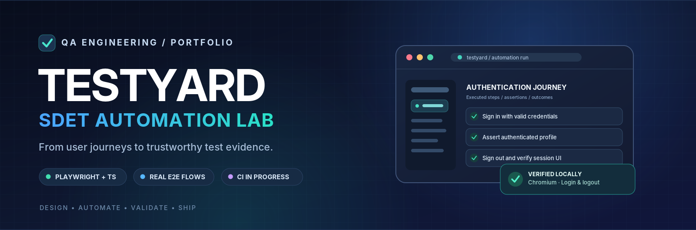
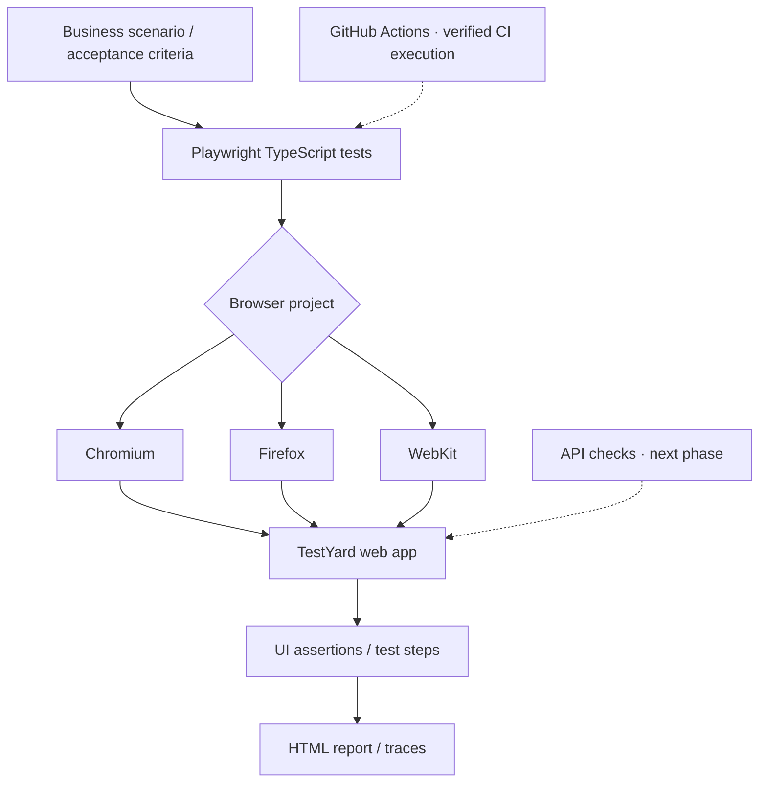
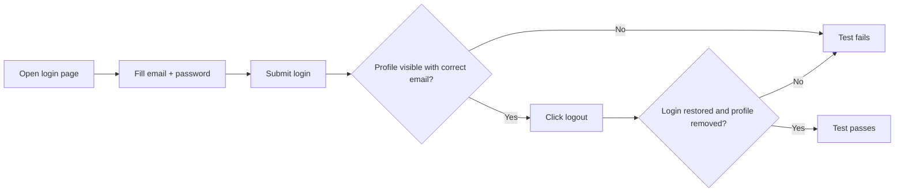

<div align="center">



# TestYard — SDET Automation Lab

### Automation that proves outcomes — from login flows to API-backed business journeys.

[](https://playwright.dev/)
[](https://www.typescriptlang.org/)
[](https://nodejs.org/)
[](https://github.com/niranjanrdy/testyard-sdet-automation/actions/workflows/playwright.yml)

**[Live practice app](https://testyard.onrender.com/practice/auth)** · **[Current test](playwright-ts/tests/auth.spec.ts)** · **[Quick start](#quick-start)** · **[Coverage](#test-coverage--execution-evidence)** · **[Architecture](#architecture--project-layout)** · **[Roadmap](#roadmap--release-milestones)**

</div>

---

## The project, in 30 seconds

**TestYard SDET Automation Lab** is a hands-on quality engineering portfolio built around [TestYard](https://testyard.onrender.com/), a public automation-practice application with authenticated workflows and APIs.

The objective is to build an automation system that an engineer can **read, execute, debug, extend, and trust**. Work is added incrementally: inspect real DOM elements, translate business requirements into test cases, assert meaningful outcomes, capture evidence, and introduce CI only after prerequisites are validated.

<table>
<tr>
<td width="33%" align="center"><strong>01</strong><br><sub>Implemented UI journey</sub><br><strong>Login → Profile → Logout</strong></td>
<td width="33%" align="center"><strong>Chromium</strong><br><sub>Locally executed</sub><br><strong>Passing</strong></td>
<td width="33%" align="center"><strong>3 engines</strong><br><sub>Playwright projects configured</sub><br><strong>3/3 CI tests passed</strong></td>
</tr>
</table>

> [!IMPORTANT]
> **Cross-browser CI verified:** The authentication test
> (TC_AUTH_001) successfully passed on Chromium, Firefox,
> and WebKit using GitHub Actions on Ubuntu 24.04.
>
> Firefox and WebKit remain blocked locally by Windows
> Code Integrity policies, but both execute successfully
> in our Linux-based CI environment.

## What this lab demonstrates

| Quality engineering capability | How it appears in the repository |
| :--- | :--- |
| **Business-oriented E2E tests** | Login, identity verification, and logout assertions rather than navigation-only scripts |
| **Maintainable TypeScript** | Descriptive test names, `test.step()` sections, typed configuration, and reusable constants |
| **Intentional locator design** | Actual DOM inspection; accessible role locators and stable `data-testid` attributes |
| **Debugging and evidence** | Playwright Inspector, HTML reporting, traces on first CI retry |
| **Execution engineering** | Locked npm dependencies, browser projects, CI-aware headless and retry settings |
| **Cross-browser strategy** | Chromium locally; Firefox/WebKit verified in GitHub Actions on GitHub-hosted Ubuntu |
| **End-to-end + API strategy** | Notes lifecycle and authenticated REST checks in the next development phase |

### A look at the code, not just the badges

This is the core **UI interaction and verification pattern** used in the implemented authentication journey:

```typescript
// Find elements using stable identifiers observed in TestYard's real DOM.
await page.getByTestId('login-email').fill(DEMO_USER.email);
await page.getByTestId('login-password').fill(DEMO_USER.password);
await page.getByRole('button', { name: 'Log in' }).click();

// Verify a business outcome: the authenticated account must be the right one.
await expect(page.getByTestId('profile-email')).toHaveText(DEMO_USER.email);
```

The full test includes **logout and signed-out-state assertions**, grouped into named `test.step()` sections. See [`auth.spec.ts`](playwright-ts/tests/auth.spec.ts). Test credentials shown in the code are TestYard's public demo values, not production secrets.

---

## Test coverage & execution evidence

**Legend:** ✅ implemented and verified · 🟡 configured/under development · ⬜ planned

| Test ID | Scenario | Layer | Chromium local | Firefox / WebKit CI |
| :--- | :--- | :--- | :---: | :---: |
| `TC_AUTH_001` | Valid login → verify account email → logout → verify signed-out UI | UI E2E | ✅ Passed | ✅ Passed |
| `TC_AUTH_002` | Invalid credentials and rejection message | UI negative | ⬜ | ⬜ |
| `TC_AUTH_003` | Authentication input validation | UI negative | ⬜ | ⬜ |
| `TC_NOTES_001` | Create → edit → complete → search → delete a note | UI E2E | ⬜ | ⬜ |
| `TC_NOTES_002` | Verify note persistence and lifecycle via REST API | UI + API | ⬜ | ⬜ |
| `TC_SHOP_001` | Product search → cart updates → checkout | UI E2E | ⬜ | ⬜ |

**Verified baseline:** `TC_AUTH_001` has passed on local Chromium. Passing another browser, adding a workflow file, or discovering a test with `--list` will **not** be recorded as a test pass without an actual successful execution.

<details>
<summary><strong>See the current authentication acceptance criteria</strong></summary>

1. Given the public practice account exists, when the user submits valid credentials, the authenticated profile appears.
2. The profile displays the email address of the account used to log in.
3. When the user logs out, the login action becomes available again.
4. The authenticated profile email is removed from the page DOM.

This is a **UI session-state check**; server-side token revocation and protected-resource access will be evaluated separately in future API tests.

</details>

---

## Architecture & project layout



**Current repository layout** (including this README package):

```text
testyard-sdet-automation/
├── README.md
├── docs/
│   └── assets/
│       └── hero.png                 # Repository header artwork
├── .gitignore                       # Excludes dependencies, reports, secrets
└── playwright-ts/
    ├── package.json                # Playwright + TypeScript dependencies
    ├── package-lock.json           # Reproducible dependency resolution
    ├── playwright.config.ts        # Browser projects and CI behavior
    ├── tsconfig.json               # TypeScript / Node type configuration
    └── tests/
        └── auth.spec.ts            # TC_AUTH_001
```

> The `.github/workflows/` pipeline, Page Objects, fixtures, Notes tests, API clients, and additional framework directories are **roadmap work**. Their presence and results will be reflected here once verified.

### Authentication user journey



The first test uses named `test.step()` sections so a failure can be associated with a specific business operation in the report.

---

## Quick start

### 1 — Prerequisites

| Requirement | Why it matters | Verify |
| :--- | :--- | :--- |
| **Node.js 26.x** + npm | Runs TypeScript/Playwright tooling | `node --version` / `npm --version` |
| **Git** | Cloning and change history | `git --version` |
| **Network access** | Reaches the externally hosted TestYard app | Open [TestYard](https://testyard.onrender.com/practice/auth) |
| **Playwright browsers** | Required to launch the selected browser engine | `npx playwright install --list` |
| **Supported OS and policies** | Browser executables and DLLs must be allowed to run | See [known limitations](#known-environment-limitations) |

**All commands below run from `playwright-ts/`, not the repository root.** The local setup uses only TestYard's published demo account; no private credentials are needed.

### 2 — Install and validate

```powershell
# From the repository root
cd playwright-ts

# Exact dependency tree from package-lock.json
npm.cmd ci

# Install the browser used for local development
npx.cmd playwright install chromium

# Confirm the test runner discovers the authentication test
npx.cmd playwright test tests/auth.spec.ts --list
```

For macOS/Linux, use `npm` and `npx` instead of the Windows `.cmd` variants.

### 3 — Run the test

```powershell
# Standard local Chromium regression
npx.cmd playwright test tests/auth.spec.ts --project=chromium

# Observe the browser window
npx.cmd playwright test tests/auth.spec.ts --project=chromium --headed

# Pause and inspect each interaction
npx.cmd playwright test tests/auth.spec.ts --project=chromium --debug

# Open the generated HTML report
npx.cmd playwright show-report
```

On systems that support all three browser engines, the corresponding test projects can be run with:

```powershell
npx.cmd playwright test tests/auth.spec.ts --project=chromium --project=firefox --project=webkit --workers=1
```

This is an **execution command**, not a claim that all three currently pass locally.

<details>
<summary><strong>Windows + fnm: Node.js commands not recognized?</strong></summary>

If a new PowerShell session cannot find `node` or `npx.cmd`, initialize the Node version manager first:

```powershell
fnm env --use-on-cd --shell powershell | Out-String | Invoke-Expression
fnm use 26
node --version
npx.cmd --version
```

Keep the repository separate from a Python `.venv`; the Playwright TypeScript module uses Node.js tooling.

</details>

---

## CI & cross-browser strategy

<div align="center">

`Push / PR` → `Checkout` → `Node 26` → `npm ci` → `Install browsers + OS deps` → `3 browser projects` → `Report artifact`

</div>

**Next milestone:** CI is implemented a GitHub Actions workflow on `ubuntu-24.04`. The job will execute from `playwright-ts/`, install Playwright browser dependencies, run the authentication test in all three browser projects, and upload the HTML report even when tests fail.

The framework already contains CI-aware settings:

| Setting | Local development | CI (implemented) |
| :--- | :--- | :--- |
| Browser UI | Headed | Headless |
| Action delay | 1,000 ms for learning | None |
| Retries | 0 | 2 |
| Workers | Playwright default | 1 |
| Reporting | List + HTML | List + uploaded HTML artifact |

## Known environment limitations

On the local **Windows 11 ARM64** development machine, Chromium has passed the authentication test. Firefox and WebKit are blocked before test execution by **Windows Code Integrity / application-control enforcement (event 3077)**. The logs identify Firefox's executable and WebKit DLLs as blocked components.

Reinstalling WebKit did not resolve the policy block. The approach for now is to **retain system protection**, develop in Chromium locally, and verify Firefox/WebKit on a supported Linux CI runner. No assertion or locator changes are required to address an OS-level browser launch block.

<details>
<summary><strong>Failure triage cheat sheet</strong></summary>

| Symptom | First diagnostic |
| :--- | :--- |
| `npx.cmd` is not recognized | Initialize fnm / verify Node PATH |
| npm `E404` for `playwrighttest` | Use `npx.cmd playwright test` with a space |
| Browser `spawn UNKNOWN` | Inspect OS security / Code Integrity events |
| WebKit reports missing DLLs | Confirm files exist and review policy blocks before reinstalling |
| `getByRole()` misses a password input | A password input has no implicit textbox role; use a label or test ID |
| Locator timeout | Check live DOM and locator uniqueness in Inspector |
| Assertion failure | Compare actual and expected business result in report/trace |

</details>

---

## Roadmap & release milestones

| Phase | Deliverable | Status |
| :--- | :--- | :--- |
| **01 · Foundation** | Git repo, Playwright TS, browser projects, documented authentication test | ✅ Implemented |
| **02 · Confidence** | CI setup, cross-browser evidence, README, negative auth tests | 🟡 In progress |
| **03 · E2E business workflow** | Notes CRUD, search, completion, isolated data and cleanup | ⬜ Planned |
| **04 · API quality** | Authenticated Notes APIs, state verification, negative and schema checks | ⬜ Planned |
| **05 · Framework design** | Page Object Model, fixtures, reusable data builders, tagging | ⬜ Planned |
| **06 · Broader portfolio** | Cypress JS for e-commerce; Selenium Python for additional workflows | ⬜ Planned |
| **07 · Engineering maturity** | Expanded regression matrix, CI artifacts, trace evidence, contributor docs | ⬜ Planned |

### Advanced engineering patterns — planned, not claimed

The next iterations will introduce these only after we have written and executed working examples:

| Pattern | Why it improves the framework | State |
| :--- | :--- | :--- |
| **Page Object Model** | Reuse login and notes page interactions across tests | Planned |
| **Custom Playwright fixtures** | Standardize authenticated sessions and test setup | Planned |
| **UI + API checks** | Verify persisted Notes data beyond UI text alone | Planned |
| **Network interception (`page.route`)** | Exercise predictable failure states and response handling | Candidate extension |
| **Accessibility checks** | Include automated accessibility checks where useful | Candidate extension |
| **Visual regression** | Detect unintended UI differences with controlled snapshots | Candidate extension |
| **Evidence/demo GIF** | Show an actual headed test run after recording it | Awaiting real recording |

A planned feature is **not** counted as implemented test coverage. Likewise, a workflow status badge will link to a real GitHub Actions run only after the repository is published and the workflow succeeds.

### How this README will evolve

Each completed milestone should update **four places**, rather than just add another badge:

1. **Coverage:** add the new test ID, scenario, scope, and verified browser results.
2. **Architecture:** add folders and modules only after they exist in the repository.
3. **Execution:** document any new prerequisites, environment variables, or commands.
4. **Evidence:** link a real CI run/report or recorded local result, including limitations.

That keeps the landing page visually polished **and** technically honest as the project grows.

---

## Previous automation experience

This repository builds on ideas from earlier projects, with a stronger focus on documented business scenarios, reproducible setup, transparent execution status, and a maintainable CI strategy.

- [WebdriverIO + Cucumber + TypeScript](https://github.com/niranjanrdy/WebdriverIOCucumberTS)
- [WebdriverIO + Mocha + TypeScript](https://github.com/niranjanrdy/WebDriverIOMochaTS)
- [WebdriverIO BDD UI Automation](https://github.com/niranjanrdy/WebDriverIO_BDD_Cucumber_UI_Automation)
- [REST Assured API Automation](https://github.com/niranjanrdy/RESTAssuredAPIAutomationTesting)

---

<div align="center">

### Built with a testing mindset.

**Understand the workflow. Choose reliable locators. Verify business outcomes. Keep the evidence.**

<sub>Independent practice project using public TestYard functionality and demo data. Not affiliated with TestYard or any employer.</sub>

</div>
